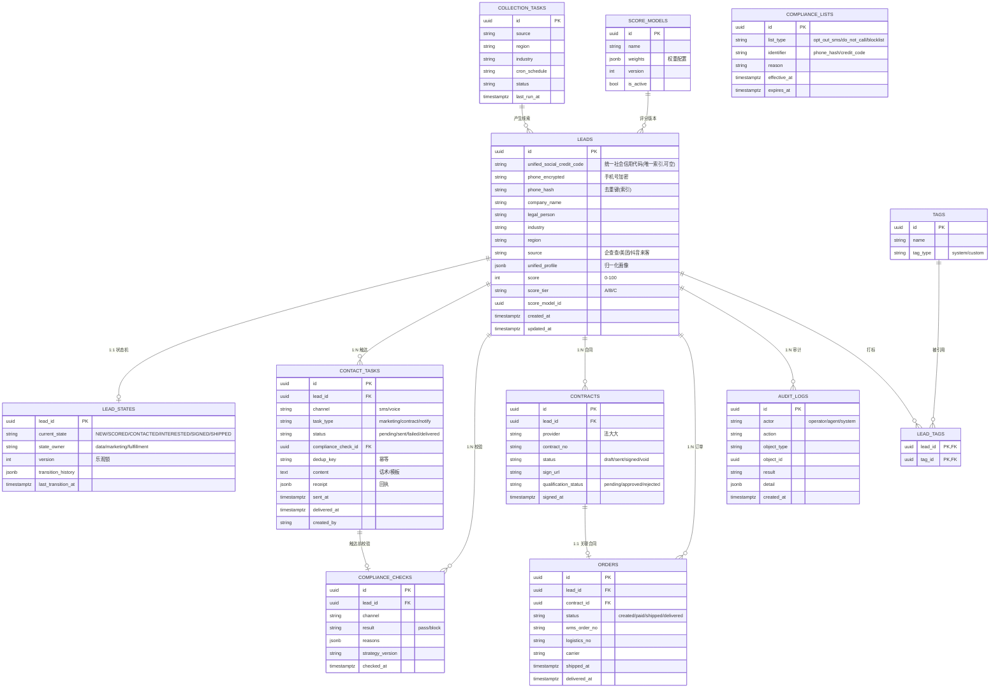
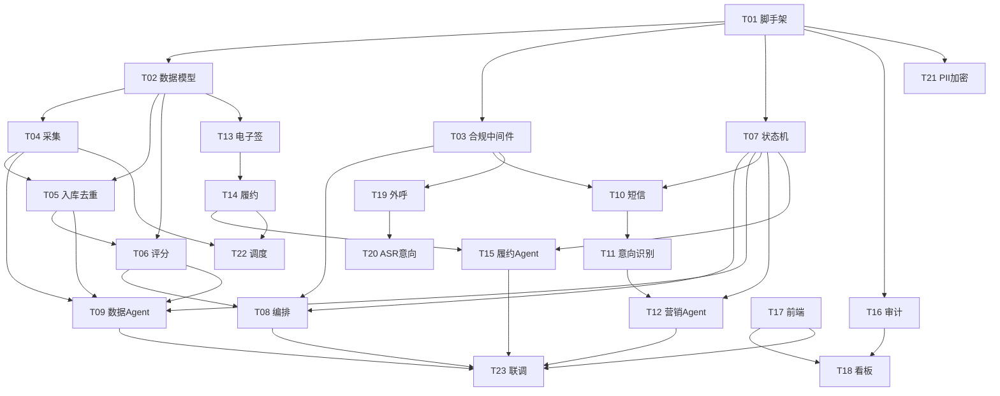

# 供应平台 supply_platform 系统架构设计与任务分解

> 角色：架构师（高见远 / Gao）｜阶段：设计（不写实现代码）｜语言：中文
> 输入：PRD（P0×10 / P1×5 / P2×4）+ 已确定架构原则（3 Agent + 合规中间件、会话隔离、单一事实源、防错乱、编排派活）

---

## 1. 总体架构

### 1.1 分层架构图


<svg viewBox="0 0 680 596" width="100%" xmlns="http://www.w3.org/2000/svg" role="img">
  <title>供应平台分层架构图</title>
  <desc>九层分层架构：UI、API网关、智能体编排、业务智能体、合规横切、业务服务、触达履约通道、数据单一事实源、观测</desc>
  <text x="20" y="28" font-size="15" font-weight="500" fill="#26215C">供应平台 · 分层架构图</text>

  <g>
    <rect x="20" y="44" width="150" height="50" rx="8" fill="#E6F1FB" stroke="#185FA5" stroke-width="0.5"/>
    <text x="95" y="69" font-size="13" font-weight="500" fill="#0C447C" text-anchor="middle" dominant-baseline="central">UI 层</text>
    <rect x="178" y="44" width="482" height="50" rx="8" fill="#ffffff" stroke="#e5e7eb" stroke-width="0.5"/>
    <text x="190" y="63" font-size="11.5" fill="#444441">仪表盘·线索池·采集任务·评分模型</text>
    <text x="190" y="81" font-size="11.5" fill="#444441">触达任务·意向工作台·签约履约·合规配置·审计</text>
  </g>

  <g>
    <rect x="20" y="103" width="150" height="50" rx="8" fill="#EEEDFE" stroke="#534AB7" stroke-width="0.5"/>
    <text x="95" y="128" font-size="13" font-weight="500" fill="#3C3489" text-anchor="middle" dominant-baseline="central">API 网关层</text>
    <rect x="178" y="103" width="482" height="50" rx="8" fill="#ffffff" stroke="#e5e7eb" stroke-width="0.5"/>
    <text x="190" y="128" font-size="11.5" fill="#444441" dominant-baseline="central">API Router v1 · 鉴权 / JWT / RBAC</text>
  </g>

  <g>
    <rect x="20" y="162" width="150" height="50" rx="8" fill="#E1F5EE" stroke="#0F6E56" stroke-width="0.5"/>
    <text x="95" y="187" font-size="13" font-weight="500" fill="#085041" text-anchor="middle" dominant-baseline="central">智能体编排层</text>
    <rect x="178" y="162" width="482" height="50" rx="8" fill="#ffffff" stroke="#e5e7eb" stroke-width="0.5"/>
    <text x="190" y="187" font-size="11.5" fill="#444441" dominant-baseline="central">编排智能体：读状态机 → 派活 → payload 投影（LangGraph）</text>
  </g>

  <g>
    <rect x="20" y="221" width="150" height="50" rx="8" fill="#FAECE7" stroke="#993C1D" stroke-width="0.5"/>
    <text x="95" y="246" font-size="13" font-weight="500" fill="#712B13" text-anchor="middle" dominant-baseline="central">业务智能体层</text>
    <rect x="178" y="221" width="482" height="50" rx="8" fill="#ffffff" stroke="#e5e7eb" stroke-width="0.5"/>
    <text x="190" y="240" font-size="11.5" fill="#444441">数据智能体（采集+筛选+入库）</text>
    <text x="190" y="258" font-size="11.5" fill="#444441">营销智能体（触达+意向识别）· 履约智能体（签约+发货）</text>
  </g>

  <g>
    <rect x="20" y="280" width="150" height="50" rx="8" fill="#FCEBEB" stroke="#A32D2D" stroke-width="0.5"/>
    <text x="95" y="305" font-size="13" font-weight="500" fill="#791F1F" text-anchor="middle" dominant-baseline="central">合规层（横切）</text>
    <rect x="178" y="280" width="482" height="50" rx="8" fill="#ffffff" stroke="#e5e7eb" stroke-width="0.5"/>
    <text x="190" y="305" font-size="11.5" fill="#444441" dominant-baseline="central">合规守护 check()：退订·谢绝来电·时段·频次·PIPL — 任何触达前强制校验</text>
  </g>

  <g>
    <rect x="20" y="339" width="150" height="50" rx="8" fill="#F1EFE8" stroke="#5F5E5A" stroke-width="0.5"/>
    <text x="95" y="364" font-size="13" font-weight="500" fill="#2C2C2A" text-anchor="middle" dominant-baseline="central">业务服务层</text>
    <rect x="178" y="339" width="482" height="50" rx="8" fill="#ffffff" stroke="#e5e7eb" stroke-width="0.5"/>
    <text x="190" y="364" font-size="11.5" fill="#444441" dominant-baseline="central">采集适配·评分引擎·入库去重打标·触达通道·电子签·订单/WMS/物流</text>
  </g>

  <g>
    <rect x="20" y="398" width="150" height="50" rx="8" fill="#FAEEDA" stroke="#854F0B" stroke-width="0.5"/>
    <text x="95" y="423" font-size="13" font-weight="500" fill="#633806" text-anchor="middle" dominant-baseline="central">触达/履约通道层</text>
    <rect x="178" y="398" width="482" height="50" rx="8" fill="#ffffff" stroke="#e5e7eb" stroke-width="0.5"/>
    <text x="190" y="423" font-size="11.5" fill="#444441" dominant-baseline="central">106短信(阿里云) · AI外呼(P1) · WMS · 快递鸟物流 · 法大大电子签</text>
  </g>

  <g>
    <rect x="20" y="457" width="150" height="50" rx="8" fill="#EAF3DE" stroke="#3B6D11" stroke-width="0.5"/>
    <text x="95" y="482" font-size="13" font-weight="500" fill="#27500A" text-anchor="middle" dominant-baseline="central">数据·单一事实源层</text>
    <rect x="178" y="457" width="482" height="50" rx="8" fill="#ffffff" stroke="#e5e7eb" stroke-width="0.5"/>
    <text x="190" y="476" font-size="11.5" fill="#444441">PostgreSQL：leads/state/contract/order/audit + pgvector</text>
    <text x="190" y="494" font-size="11.5" fill="#444441">Redis：频次限流 · 去重 · 幂等键 · 缓存 · 队列</text>
  </g>

  <g>
    <rect x="20" y="516" width="150" height="50" rx="8" fill="#FBEAF0" stroke="#993556" stroke-width="0.5"/>
    <text x="95" y="541" font-size="13" font-weight="500" fill="#72243E" text-anchor="middle" dominant-baseline="central">观测层</text>
    <rect x="178" y="516" width="482" height="50" rx="8" fill="#ffffff" stroke="#e5e7eb" stroke-width="0.5"/>
    <text x="190" y="541" font-size="11.5" fill="#444441" dominant-baseline="central">审计日志 · 转化漏斗看板 · 异常告警</text>
  </g>

  <text x="20" y="582" font-size="11" fill="#6b7280">数据自上而下流转；合规层横切于所有触达动作之前。</text>
</svg>


### 1.2 职责边界（3 Agent + 合规中间件）

| 角色 | 管辖状态 | 工具范围（隔离，互不可见） | 核心职责 | 不可越界 |
|------|---------|------------------------|---------|---------|
| **编排智能体** Orchestrator | 全局只读状态机 | 状态机读取、派活、payload 投影 | 读 `lead_state` → 决定下一步 → 派活给对应 agent（只传 `lead_id` + 字段投影）；不持有业务工具 | 不直接改线索业务字段、不触达 |
| **数据智能体** Data Agent | NEW→SCORED | 采集API、归一化、评分、CRM入库 | 采集 → 归一化 → 去重合并 → 评分分层 → 打标 | 不触达、不签约 |
| **营销智能体** Marketing Agent | SCORED→CONTACTED→INTERESTED | 短信/外呼通道、回执解析、关键词/ASR意向 | 经合规中间件校验后触达；回执/关键词/ASR 识别意向 | 不入库、不签约 |
| **履约智能体** Fulfillment Agent | INTERESTED→SIGNED→SHIPPED | 电子签、订单、WMS、物流 | 电子签约+资质审核 → 生成订单 → WMS → 物流 → 通知 | 不采集、不触达 |
| **合规守护**（横切） | 无状态归属 | 合规名单、频次计数、时段/PIPL 校验 | 任何触达前强制调用 `check()`；不通过即阻断 + 记录 | 只读校验，不持有业务状态 |

**硬约束**：只有「当前状态归属的 agent」能改该线索对应阶段字段；状态迁移统一经 `state.transition()`（DB 事务 + 行锁 + 幂等键）；agent 之间不直接对话，只经结构化数据库协作。

---

## 2. 框架与技术选型结论

| 默认项 | 决策 | 选型 / 替代 | 理由 |
|--------|------|------------|------|
| 前端 | 采用 | Vite + React 18 + MUI 5 + Tailwind | 管理后台表单/表格/看板密集，MUI 组件完备，Tailwind 加速定制 |
| 后端 | 采用 | Python + FastAPI | 异步高并发触达回调、生态成熟（SQLAlchemy/pydantic/Celery） |
| 数据库 | 采用 | PostgreSQL 16 + pgvector | 状态机/审计强一致；pgvector 支撑画像语义检索（P1） |
| 缓存/队列 | 采用 | Redis 7 | 频次限流、去重、幂等键、缓存、轻量队列 |
| **多智能体编排** | 采用（推荐） | **LangGraph** | 状态图 + checkpointer 与「状态机驱动派活」天然契合；支持 human-in-loop 合规复核；LLM-native 适配评分/意向推理；与 FastAPI 易集成。3 个 agent 各自独立 graph/thread，互不可见 |
| **调度框架** | 采用（推荐） | **Temporal**（主）+ Celery/Redis（次，MVP 兜底） | Temporal 原生持久化重试/超时/可观测，契合合规审计；采集 pipeline、签约履约、留存清理用 Temporal Workflow。MVP 若运维压力大，退化为 Celery + Beat |
| **短信通道** | 采用 | **阿里云短信（含 106 实名通道）** | 国内 106 实名备案成熟、回执/退订回传完备；腾讯云为备选 |
| **外呼（语音）** | P1 采用 | **阿里云智能外呼**（容联七陌备选） | 与短信同生态；但 MVP 不含 AI 外呼，仅短信 |
| **电子签** | 采用 | **法大大 Fadada**（e签宝备选） | API 成熟、B2B 合规好、资质审核接口完善 |
| **物流** | 采用 | **快递鸟 kdniao** | 聚合多家快递，回传物流轨迹标准 |
| **WMS** | 采用（假设既有） | 既有 WMS（适配器模式，无则 stub） | 多数客户已有 WMS，提供 adapter；无则内存 stub |
| **观测** | 采用 | 审计日志表 + Prometheus/Grafana + 看板 | 审计全量留痕；漏斗看板用 API 聚合 |

### 2.1 待确认问题 → 推荐默认值

| 待确认问题 | 推荐默认值 | 影响 |
|-----------|-----------|------|
| 目标行业/区域 | 全国 + 餐饮/零售/生活服务（美团/抖音来客门店为主），可配置 | 决定采集源与区域过滤参数 |
| 初期数据规模 | 日采集 1–5 万线索；峰值按 10 万规划 | 决定 PG 分区、Redis 容量、通道配额 |
| 外呼服务商 | 阿里云智能外呼（P1 启用） | MVP 无影响 |
| 电子签服务商 | 法大大 | 接口适配工作量 |
| 短信 106 通道 | 阿里云短信（106 实名） | 退订回传实现 |
| PIPL 合法基础 | 触达采用「明示同意」(opt-in / 退订即撤销)；签约后履约用「合同必要」 | 合规中间件校验逻辑 |
| 数据源授权与配额 | 企查查商业授权 + 美团/抖音来客开放平台授权；按日配额限流 | 采集成功率 / 配额管理 |
| WMS/物流是否既有 | WMS 假设既有（adapter）；物流用快递鸟 | 履约对接范围 |
| 多智能体编排框架 | LangGraph | 编排层实现 |
| MVP 是否含 AI 外呼 | **否**，首期仅短信（与团队建议一致） | 范围收敛 |

---

## 3. 目录 / 文件结构

### 3.1 后端（Python / FastAPI）

```
backend/
├── app/
│   ├── main.py                      # FastAPI 入口、挂载 v1 路由、中间件
│   ├── core/
│   │   ├── config.py                # 配置(pydantic-settings)
│   │   ├── db.py                    # SQLAlchemy engine/session
│   │   ├── redis.py                 # Redis 连接池
│   │   ├── security.py              # PII 加密(Fernet/KMS)、JWT、RBAC
│   │   ├── idempotency.py           # 幂等键生成/校验
│   │   └── constants.py             # 状态/枚举/错误码常量
│   ├── db/
│   │   ├── models/                  # ORM: leads, lead_states, contact_tasks, ...
│   │   ├── schemas/                 # pydantic 出入参
│   │   └── migrations/              # Alembic
│   ├── agents/
│   │   ├── orchestrator/            # 编排智能体 (LangGraph graph)
│   │   │   ├── graph.py
│   │   │   └── router.py            # 读状态机→派活逻辑
│   │   ├── data_agent/              # 采集+筛选+入库
│   │   │   ├── agent.py
│   │   │   └── tools.py             # 仅采集/归一化/评分/CRM 工具
│   │   ├── marketing_agent/         # 触达+意向识别
│   │   │   ├── agent.py
│   │   │   └── tools.py             # 仅短信/外呼/回执/关键词工具
│   │   ├── fulfillment_agent/       # 签约+发货
│   │   │   ├── agent.py
│   │   │   └── tools.py             # 仅电子签/订单/WMS/物流工具
│   │   └── compliance/              # 合规中间件(横切)
│   │       ├── middleware.py        # check() 入口
│   │       ├── rules/               # 退订/谢绝来电/时段/频次/PIPL
│   │       └── lists.py             # 名单读写
│   ├── services/
│   │   ├── collection/              # 企查查/美团/抖音 adapters
│   │   ├── scoring/                 # 评分模型引擎
│   │   ├── crm/                     # 入库/去重/打标
│   │   ├── outreach/                # 短信/外呼通道封装
│   │   ├── esign/                   # 法大大封装
│   │   └── fulfillment/             # 订单/WMS/物流
│   ├── api/v1/                      # REST 路由
│   │   ├── leads.py  collection_tasks.py  scoring.py
│   │   ├── contact.py  contracts.py  orders.py
│   │   ├── compliance.py  audit.py  dashboard.py  tags.py
│   ├── workers/
│   │   ├── celery_app.py
│   │   └── temporal/                # workflows/activities
│   └── observability/               # 审计写入、指标
├── tests/
├── pyproject.toml  requirements.txt  Dockerfile  alembic.ini
```

### 3.2 前端（Vite + React + MUI + Tailwind）

```
frontend/
├── index.html  vite.config.ts  tailwind.config.js  tsconfig.json  package.json
├── src/
│   ├── main.tsx  App.tsx  router.tsx
│   ├── api/                      # axios 客户端 + 各模块 API
│   ├── components/               # 通用组件(Table/Form/Dialog/Chart)
│   ├── pages/
│   │   ├── dashboard/            # 仪表盘/漏斗
│   │   ├── lead-pool/            # 线索池
│   │   ├── collection-tasks/     # 采集任务
│   │   ├── scoring-models/       # 评分模型
│   │   ├── outreach/             # 触达任务(短信/外呼)
│   │   ├── intent-workbench/     # 意向工作台
│   │   ├── contracts-fulfillment/# 签约与履约
│   │   ├── compliance-config/    # 合规配置
│   │   ├── audit-logs/           # 审计日志
│   │   └── settings/             # 系统设置
│   ├── store/                    # zustand 状态
│   ├── types/                    # TS 类型(对齐 API)
│   └── utils/
```

---

## 4. 核心数据模型

### 4.1 ER 图

> 完整图见 `docs/class-diagram.mermaid`（便于独立渲染）。



### 4.2 关键状态枚举（单一事实源）

| 状态机 `lead_state` | 含义 | 归属 agent |
|--------------------|------|-----------|
| `NEW` | 采集入库未评分 | data |
| `SCORED` | 已评分分层 | data |
| `CONTACTED` | 已触达（短信已发） | marketing |
| `INTERESTED` | 意向识别命中 | marketing |
| `SIGNED` | 电子签约完成 | fulfillment |
| `SHIPPED` | 已发货履约 | fulfillment |

**合法迁移（仅相邻）**：`NEW → SCORED → CONTACTED → INTERESTED → SIGNED → SHIPPED`；`INTERESTED` 可人工回退 `CONTACTED`（误判修正）。非法迁移一律拒绝并记录。

---

## 5. 接口 / 契约

### 5.1 REST API 端点（摘要）

| 模块 | 方法 | 路径 | 入参 | 出参 |
|------|------|------|------|------|
| 线索 | GET | `/api/v1/leads` | filter(状态/标签/行业/区域/分页) | `Lead[] + total` |
| 线索 | GET | `/api/v1/leads/{id}` | — | `LeadDetail`(含 state/tags/audit) |
| 线索 | PATCH | `/api/v1/leads/{id}/tags` | `tags[]` | 200 |
| 采集 | POST | `/api/v1/collection-tasks` | `source/region/industry/cron` | `task` |
| 采集 | POST | `/api/v1/collection-tasks/{id}/run` | — | async task id |
| 评分 | GET/PUT | `/api/v1/scoring/models/{id}` | `weights` | `model + 重算触发` |
| 评分 | POST | `/api/v1/scoring/recalc` | `model_id/lead_ids` | async |
| 触达 | POST | `/api/v1/contact/tasks` | `lead_ids/channel/template` | `tasks[]` |
| 触达 | POST | `/api/v1/contact/receipt` | `task_id/raw` | 意向更新 |
| 意向 | GET | `/api/v1/intent/workbench` | filter | 待处理意向 |
| 意向 | PATCH | `/api/v1/leads/{id}/intent` | `interested/人工修正` | 200 |
| 签约 | POST | `/api/v1/contracts` | `lead_id` | `contract(sign_url)` |
| 签约 | POST | `/api/v1/contracts/callback` | provider 事件 | 状态更新 |
| 履约 | POST | `/api/v1/orders` | `contract_id` | `order` |
| 履约 | POST | `/api/v1/orders/{id}/ship` | `wms/logistics` | 200 |
| 合规 | GET/POST | `/api/v1/compliance/lists` | `type/identifier` | 名单 CRUD |
| 合规 | GET | `/api/v1/compliance/check` | `lead_id/channel` | `pass/block + reasons` |
| 审计 | GET | `/api/v1/audit-logs` | filter/分页/导出 | `logs` |
| 看板 | GET | `/api/v1/dashboard/funnel` | `date_range` | 漏斗/分布 |

> 所有响应统一 `{ code, data, message }`；错误码见 §9。

### 5.2 核心函数签名（agent / 服务间）

```python
# 合规中间件（横切，任何触达前调用）
compliance.check(lead_id: str, channel: str) -> ComplianceResult
# ComplianceResult: {result: "pass"|"block", reasons: list[str], strategy_version: str}

# 状态机（DB 事务 + 行锁 + 版本）
state.transition(lead_id: str, to_state: str, actor: str, payload: dict) -> bool
state.get(lead_id: str) -> LeadState
state.assert_owner(lead_id: str, agent: str) -> None   # 非归属则抛错

# 数据智能体
data_agent.collect(task_id: str) -> list[RawLead]
data_agent.normalize(raw: RawLead) -> UnifiedLead
data_agent.dedup(lead: UnifiedLead) -> Lead
data_agent.score(lead_id: str, model_version: int) -> ScoreResult
data_agent.tag(lead_id: str, tags: list[str]) -> None

# 营销智能体
marketing_agent.send_sms(lead_id: str, template: str) -> ContactTask
marketing_agent.classify_intent(receipt: str) -> Intent          # 关键词/ASR
marketing_agent.correct_intent(lead_id: str, value: bool, by: str) -> None

# 履约智能体
fulfillment_agent.create_contract(lead_id: str) -> Contract
fulfillment_agent.review_qualification(contract_id: str, files: list) -> Status
fulfillment_agent.create_order(contract_id: str) -> Order
fulfillment_agent.ship(order_id: str) -> Shipment
fulfillment_agent.notify_customer(order_id: str) -> None

# 编排智能体
orchestrator.route(lead_id: str) -> Dispatch   # 读 state → 选 agent + payload 投影
```

---

## 6. 多智能体协作时序图

> 完整图见 `docs/sequence-diagram.mermaid`（一条线索从采集到发货的完整流转）。

**关键路径摘要**：
1. Orchestrator 读 `lead_state=NEW` → 派活 Data Agent（`lead_id`）。
2. Data Agent：collect → normalize → dedup(CRM upsert) → score；`state.transition(NEW→SCORED)`，写审计。
3. Orchestrator 读 `SCORED` → 派活 Marketing Agent。
4. Marketing Agent：**先调 `compliance.check()`** → 不通过即阻断+记录；通过 → `send_sms` → 通道回执 → `classify_intent` → `CONTACTED→INTERESTED`。
5. Orchestrator 读 `INTERESTED` → 派活 Fulfillment Agent。
6. Fulfillment Agent：`create_contract`(法大大) → 资质审核 → `SIGNED` → `create_order` → `ship`(WMS+物流) → 通知 → `SHIPPED`。
7. 每步均写审计日志；重复事件经 `dedup_key` 幂等丢弃。

---

## 7. 任务分解列表（核心交付）

> 规则：按「实现顺序 + 依赖」排列；`T01–T05` 为地基与横切，之后按 P0 模块推进；标注可并行项。
> 覆盖范围：**P0 全量（R-P0-1 ~ R-P0-10）+ P1 关键（看板/外呼/ASR/PII 加密/分权限）**。共 23 条。

| 任务ID | 所属模块 | PRD需求 | 任务名 | 依赖 | 实现方式 | 预估产出文件 |
|--------|---------|--------|--------|------|---------|-------------|
| **T01** | 基础设施 | — | 项目脚手架与 CI | — | 串行先行 | `backend/`(pyproject/Dockerfile/main.py/core), `frontend/`(vite/ts/tailwind/package.json) |
| **T02** | 数据层 | P0-9,R-P0-3 | 数据模型与迁移 | T01 | 串行 | `db/models/*`, `alembic`, `core/db.py`, `redis.py` |
| **T03** | 合规层 | P0-4 | 合规守护中间件 | T01,T02 | 可并行 T02 | `agents/compliance/*`, 名单读写服务 |
| **T04** | 采集 | P0-1 | 数据源适配与采集 | T02 | 并行 T03 | `services/collection/*`, `api/collection_tasks.py` |
| **T05** | 入库去重 | P0-3 | CRM 入库去重打标 | T02,T04 | 依赖 T04 | `services/crm/*`, `api/leads.py`, `tags` |
| **T06** | 评分 | P0-2 | 评分模型引擎 | T02,T05 | 依赖 T05 | `services/scoring/*`, `api/scoring.py`, `score_models` |
| **T07** | 状态机 | P0-9 | 状态机与幂等锁 | T02 | 可并行 | `core/idempotency.py`, state service, `api` |
| **T08** | 编排 | P0-9 | 编排智能体(LangGraph) | T03,T06,T07 | 依赖 T06,T07 | `agents/orchestrator/*` |
| **T09** | 数据 Agent | P0-1/2/3 | 数据智能体封装 | T04,T05,T06,T07 | 依赖 T07 | `agents/data_agent/*` |
| **T10** | 短信触达 | P0-5 | 短信通道 + 退订回传 | T03,T07 | 依赖 T03 | `services/outreach/sms`, `api/contact.py` |
| **T11** | 意向识别 | P0-6 | 回执/关键词意向 | T10 | 依赖 T10 | `marketing_agent classify`, `api/intent` |
| **T12** | 营销 Agent | P0-5/6 | 营销智能体封装 | T10,T11,T07 | 依赖 T11 | `agents/marketing_agent/*` |
| **T13** | 电子签 | P0-7 | 法大大签约 + 资质 | T07 | 并行 T10 | `services/esign`, `api/contracts.py` |
| **T14** | 履约 | P0-8 | 订单/WMS/物流 | T13 | 依赖 T13 | `services/fulfillment/*`, `api/orders.py` |
| **T15** | 履约 Agent | P0-7/8 | 履约智能体封装 | T13,T14,T07 | 依赖 T14 | `agents/fulfillment_agent/*` |
| **T16** | 审计 | P0-10 | 审计日志全量留痕 | T02 | 可并行 | `observability/audit`, `api/audit.py` |
| **T17** | 前端后台 | P0 全部 | 管理后台核心页面 | T02(类型对齐) | 并行后端 | `frontend/src/pages/*`, api clients |
| **T18** | 看板 | P1-3 | 仪表盘与转化漏斗 | T16,T17 | 依赖 T17 | `api/dashboard.py`, `pages/dashboard` |
| **T19** | AI 外呼 | P1-1 | 外呼通道（P1 启用） | T03,T07 | 依赖 T03 | `services/outreach/voice`, agent 工具 |
| **T20** | ASR 意向 | P1-2 | 通话 ASR 意向识别 | T19 | 依赖 T19 | `marketing_agent asr classify` |
| **T21** | PII 加密 | P1-5 | PII 加密与分权限 | T01 | 可并行 | `core/security.py`, RBAC |
| **T22** | 调度 | P0-1,R-P2-3 | Temporal/Celery 调度 | T04,T14 | 依赖采集/履约 | `workers/*`, cron 接入 |
| **T23** | 集成联调 | 全部 | 端到端联调与压测 | T08,T09,T12,T15,T17 | 末置 | 联调脚本/文档 |

### 7.1 依赖关系图



### 7.2 并行 / 串行建议

- **可并行（地基之上独立模块）**：`T03 ‖ T04 ‖ T07 ‖ T13 ‖ T16 ‖ T21` 互不依赖，可在 `T02` 完成后并行开工。
- **业务服务串行链**：采集 `T04` → 入库 `T05` → 评分 `T06` → 数据 Agent `T09`（必须顺序）。
- **触达链**：合规 `T03` → 短信 `T10` → 意向 `T11` → 营销 Agent `T12`（必须顺序）。
- **履约链**：电子签 `T13` → 履约 `T14` → 履约 Agent `T15`（必须顺序）。
- **收口**：编排 `T08`、前端 `T17` 完成后，看板 `T18` 与联调 `T23` 末置。

---

## 8. 依赖包列表

**后端（requirements.txt 摘要）**
```
fastapi==0.110.*            # Web 框架
uvicorn[standard]           # ASGI 服务
pydantic / pydantic-settings
sqlalchemy==2.*             # ORM
alembic                     # 迁移
asyncpg                    # PG 异步驱动
pgvector                    # 向量检索(P1)
redis==5.*                  # 缓存/队列/频次
celery==5.*                 # 轻量异步(MVP 兜底)
langgraph / langchain       # 编排智能体
cryptography                # PIPL PII 加密(Fernet)
pyjwt                       # 鉴权
httpx                       # 通道 HTTP 调用
tenacity                    # 失败重试留痕
temporalio                  # 调度(可选,优先)
prometheus-client           # 指标
```

**前端（package.json 摘要）**
```
react@^18.2  react-dom  react-router-dom
@mui/material @mui/icons-material @emotion/react @emotion/styled
tailwindcss postcss autoprefixer
axios                         # API 客户端
zustand                       # 状态管理
@mui/x-charts / recharts     # 漏斗/分布看板
react-hook-form + zod        # 表单校验
dayjs                        # 时区(Asia/Shanghai)
```

---

## 9. 共享知识 / 跨文件约定

- **命名规范**：表/字段/Python 模块 `snake_case`；API 路径小写中划线；前端组件 `PascalCase`；TS 类型与 API schema 同名对齐。
- **错误码**：统一响应 `{ code, data, message }`。业务码前缀：`C_`(合规拦截) / `S_`(状态机) / `D_`(去重) / `A_`(鉴权)，统一定义于 `core/constants.py`。
- **状态枚举常量**：`LeadState.NEW/SCORED/CONTACTED/INTERESTED/SIGNED/SHIPPED` 单一定义，前后端共享（前端 `types/` 镜像）。
- **幂等 / 锁约定**：
  - 所有触达与计分写入带 `dedup_key`（`lead_id + channel + 周期`）。
  - 状态迁移用 `SELECT ... FOR UPDATE` 行锁 + `version` 乐观锁双保险。
  - 重复事件以 `dedup_key` 幂等丢弃，返回原结果。
- **时间 / 时区**：全库 `timestamptz` 存 UTC；业务展示用 `Asia/Shanghai`；呼叫时段 9:00–21:00 以用户所在时区判定（默认上海）；日志保留期默认 365 天（R-P2-3）。
- **PII 处理**：手机号/信用代码等加密存储（Fernet 或 KMS）；Redis 仅存 hash 用于去重；密文字段命名 `*_encrypted`，明文投影按需解密。

---

## 10. 待明确事项（架构层需拍板）

| 事项 | 推荐 | 影响 |
|------|------|------|
| 电子签最终选型 | 法大大 | `T13` esign 适配 |
| 短信服务商最终 | 阿里云(106) | `T10` outreach 适配 |
| PIPL 合法基础确认 | 触达=明示同意 | 合规中间件规则（`T03`） |
| 数据源授权/配额 | 企查查 + 美团/抖音来客授权 | 采集成功率（`T04`） |
| WMS 是否既有 | 既有→adapter；无→stub | 履约对接范围（`T14`） |
| 日采集量级确认 | 1–5 万（峰值 10 万） | 容量规划（PG 分区/Redis） |
| 编排框架确认 | LangGraph | 编排层实现（`T08`） |
| 调度框架（Temporal vs Celery） | Temporal 优先，MVP 可 Celery | `workers` 实现（`T22`） |
| 外呼是否首期启用 | 否（仅短信） | 范围收敛 |
| MVP 是否含 PII 加密/RBAC | 建议含（合规硬约束） | `T21` 优先级 |
```
